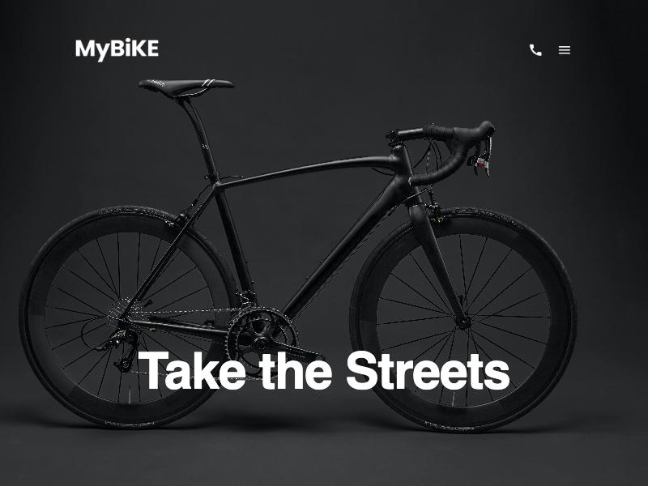

# MyBike — Landing Page

A responsive landing page for a city bike brand, built with semantic HTML and
SCSS. No CSS frameworks: the layout, the full-screen menu and the form
validation all work without custom JavaScript.

**[Live demo](https://royko7.github.io/Landing-page/)**



## Features

- **Responsive layout** with mobile-first breakpoints at 488, 744 and 1024 px
- **CSS-only full-screen menu** built on the `:target` pseudo-class
- **Contact form validation** using native HTML constraints, with invalid fields
  highlighted through `:user-invalid`
- **Smooth anchor navigation** that respects `prefers-reduced-motion`
- **Hover effects** on images, buttons and menu links

## Tech Stack

- HTML5
- SCSS: variables, mixins, one partial per page block
- BEM naming
- Flexbox and CSS Grid
- Parcel
- Stylelint, LintHTML and Prettier

## Project Structure

```
src/
├── images/
├── scripts/
├── styles/
│   ├── blocks/        # header, bikes list, details, contact form
│   ├── main.scss
│   ├── mixins.scss
│   └── variables.scss
└── index.html
```

## Getting Started

You need Node.js 20.

```bash
git clone https://github.com/Royko7/Landing-page.git
cd Landing-page
npm install
npm start
```

## Scripts

| Command          | Description                     |
| ---------------- | ------------------------------- |
| `npm start`      | Start the development server    |
| `npm run build`  | Create a production build       |
| `npm run lint`   | Run the linters                 |
| `npm run deploy` | Publish the site to GitHub Pages |

## License

Distributed under the GPL-3.0 license. See [LICENSE](LICENSE).
